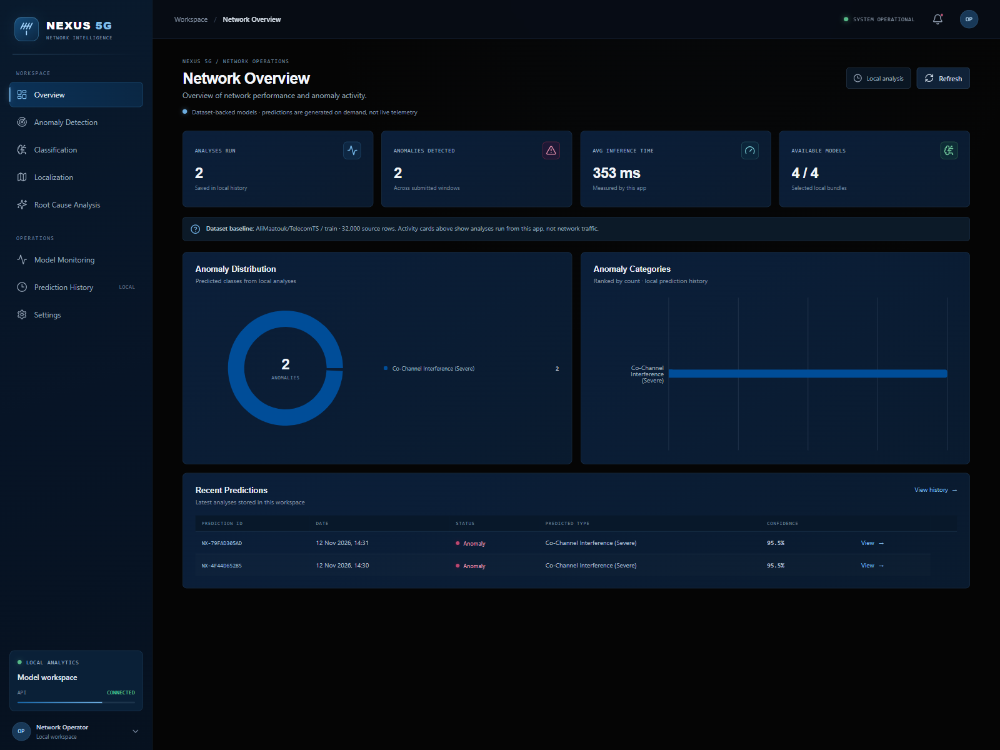
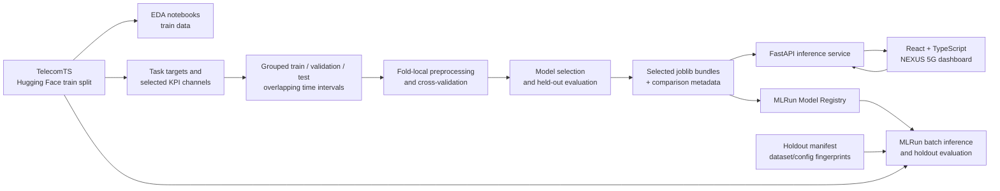
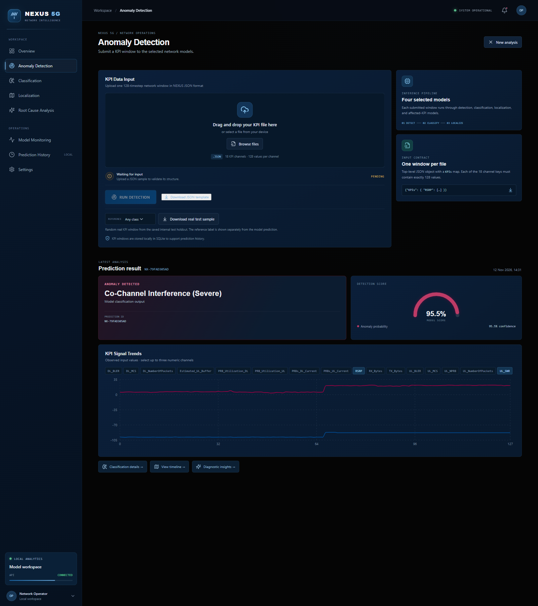
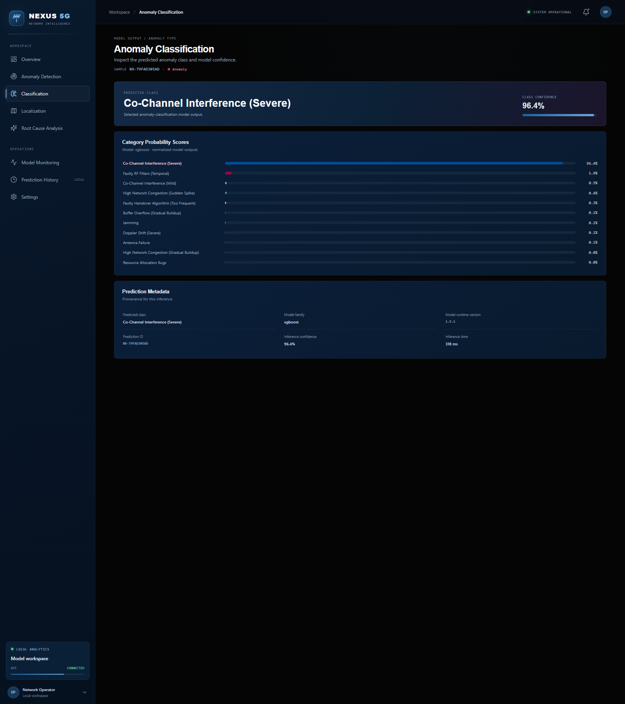
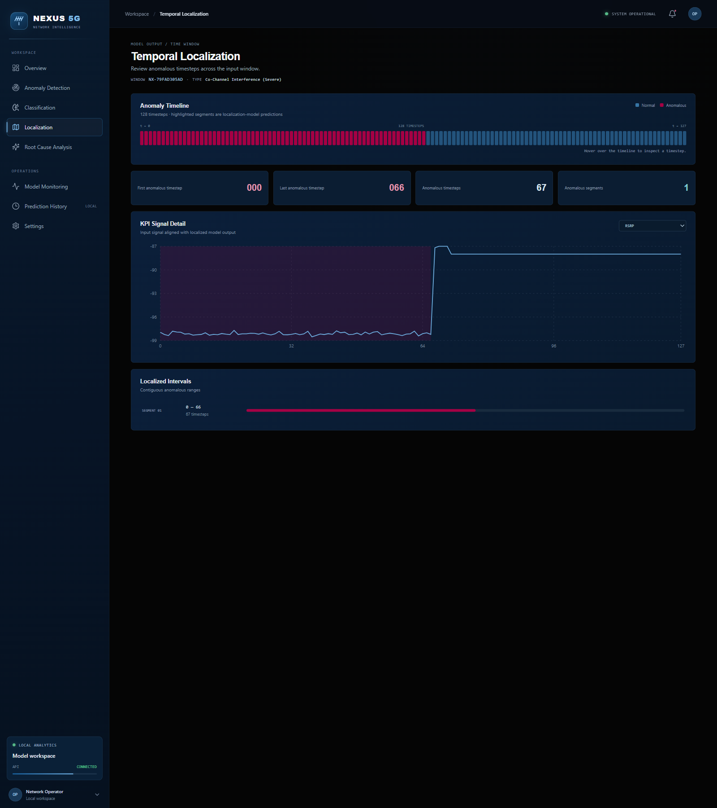
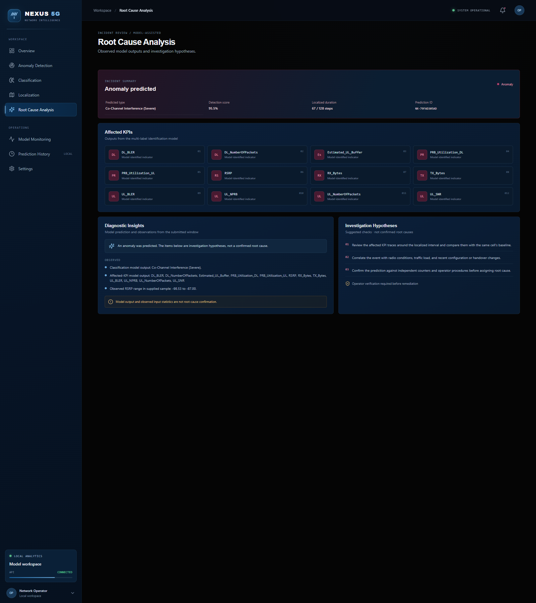
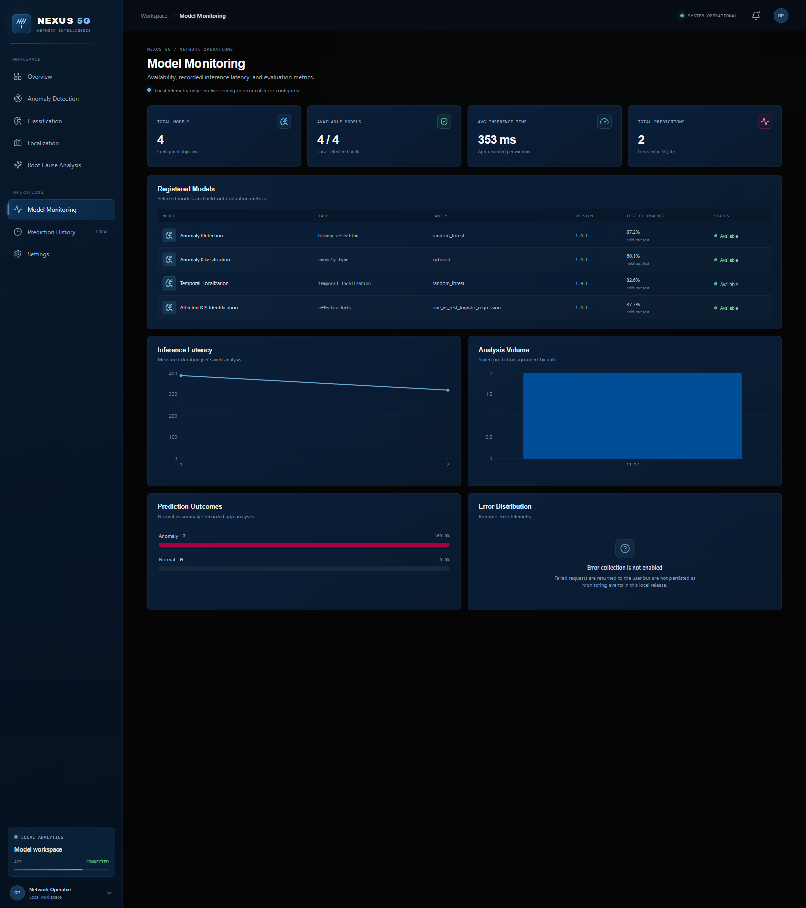
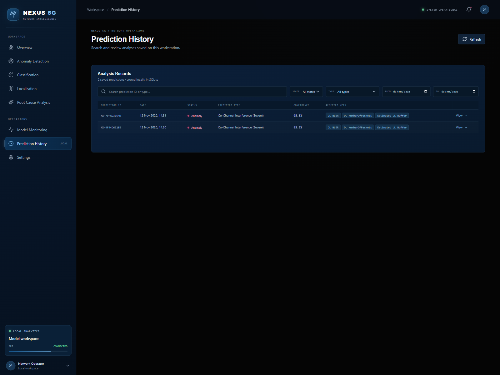

# NEXUS 5G — Network Intelligence

<p align="center">
  <strong>A practical 5G network analytics platform for KPI anomaly detection, classification, localization, and investigation.</strong>
</p>

<p align="center">
  <a href="https://huggingface.co/datasets/AliMaatouk/TelecomTS"></a>
  
  
  
  
  
</p>

NEXUS 5G is a portfolio-scale machine-learning and MLOps project built around
the public [TelecomTS dataset](https://huggingface.co/datasets/AliMaatouk/TelecomTS).
It trains task-specific models and presents their predictions in a dark,
Network Operations Center-inspired web application. It is an analytics demo,
not a live network monitor or an operational telecom system.

> **Demo notice:** The dashboard analyzes submitted 128-timestep KPI windows.
> It does not connect to a live 5G network. The public Render configuration is
> an unauthenticated portfolio demo; do not submit real or sensitive telemetry.

<p align="center">
  
</p>

## Contents

- [NEXUS 5G — Network Intelligence](#nexus-5g--network-intelligence)
  - [Contents](#contents)
  - [Problem and objectives](#problem-and-objectives)
  - [Architecture](#architecture)
  - [Dataset](#dataset)
  - [Exploration and preprocessing](#exploration-and-preprocessing)
  - [Machine-learning tasks](#machine-learning-tasks)
    - [Binary anomaly detection](#binary-anomaly-detection)
    - [Multiclass anomaly classification](#multiclass-anomaly-classification)
    - [Temporal anomaly localization](#temporal-anomaly-localization)
    - [Affected KPI identification](#affected-kpi-identification)
  - [Training and evaluation](#training-and-evaluation)
  - [MLRun integration](#mlrun-integration)
  - [Application](#application)
    - [Interface screenshots](#interface-screenshots)
  - [Project structure](#project-structure)
  - [Installation and setup](#installation-and-setup)
    - [Requirements](#requirements)
  - [Run the application](#run-the-application)
    - [Train or restore model artifacts](#train-or-restore-model-artifacts)
    - [Start the backend and frontend](#start-the-backend-and-frontend)
    - [Public demo deployment](#public-demo-deployment)
  - [REST API](#rest-api)
  - [Results and performance](#results-and-performance)
  - [Limitations and future work](#limitations-and-future-work)
  - [Technologies](#technologies)
  - [Author](#author)
  - [License and Data Attribution](#license-and-data-attribution)
    - [Repository License](#repository-license)
    - [Dataset License](#dataset-license)
    - [Dataset Citation](#dataset-citation)

## Problem and objectives

5G networks produce high-volume, bursty measurements across radio, protocol,
and traffic layers. Anomalous behavior may be rare, span only part of a time
window, and affect several KPIs at once. Detecting an event is therefore only
one part of an investigation: operators also need a useful classification,
time localization, and an indication of which measurements to inspect.

NEXUS 5G frames this as four related supervised-learning tasks:

| Objective | Question | Model output |
|---|---|---|
| Anomaly Detection | Does this window contain an anomaly? | Normal/anomaly label and anomaly score |
| Anomaly Classification | Which of the 11 anomaly categories best matches it? | Predicted class and class scores |
| Temporal Localization | Which timesteps are affected? | 128 binary timestep predictions and contiguous segments |
| Affected KPI Identification | Which KPIs are associated with the event? | Multi-label set of KPI names |

The application combines these outputs to support inspection. Its diagnostic
text is explicitly presented as **investigation guidance**, not a confirmed
root cause.

## Architecture



Training and model selection are performed locally by `ina-train-models`.
Selected model bundles include their fitted preprocessing and target
transformations. The FastAPI application loads these local bundles for
interactive inference. MLRun is a separate post-training workflow for model
registration, run provenance, batch inference, and held-out evaluation; the
API does not fetch models from MLRun at request time.

## Dataset

The project uses
[TelecomTS](https://huggingface.co/datasets/AliMaatouk/TelecomTS), a public
observability dataset derived from a 5G testbed. The dataset card reports one
`train` split containing 32,000 windows, sampled at 10 Hz. Each window contains
128 timesteps and 18 KPI channels (10 floating-point, 6 integer, and 2
categorical). The source contains 1,235 anomalous windows across 11 anomaly
types.

The source dataset exposes `train`, not a separate official test split. This
project creates internal train, validation, and test partitions from that
source split. The held-out test results below therefore measure the project's
partition of TelecomTS `train`; they are not results on an independent
publisher-provided test split.

Useful references:

- [TelecomTS dataset and data card](https://huggingface.co/datasets/AliMaatouk/TelecomTS)
- [Original TelecomTS repository](https://github.com/Ali-maatouk/TelecomTS)
- [TelecomTS paper (arXiv:2510.06063)](https://arxiv.org/abs/2510.06063)

## Exploration and preprocessing

The notebooks document the dataset exploration, task-specific target
distributions, missing-value inspection, KPI comparisons, temporal patterns,
and the rationale for selecting input channels. EDA plots use training
windows; model evaluation uses the separate validation and internal test
partitions.

Feature channels are configured per objective in [`config.yaml`](config.yaml):

| Task | Selected input channels |
|---|---|
| Binary detection | `RSRP`, `UL_SNR`, `UL_BLER`, `DL_BLER`, `RX_Bytes` |
| Anomaly type | `RSRP`, `UL_SNR`, `DL_MCS`, `UL_NPRB`, `PRBs_DL_Current`, `DL_BLER`, `UL_NumberOfPackets`, `Estimated_UL_Buffer`, `PRB_Utilization_UL` |
| Temporal localization | `RSRP`, `TX_Bytes`, `UL_NPRB`, `DL_BLER`, `UL_SNR`, `RX_Bytes`, `PRB_Utilization_DL`, `DL_MCS`, `UL_NumberOfPackets`, `Estimated_UL_Buffer`, `UL_BLER` |
| Affected KPIs | `RSRP`, `DL_MCS`, `DL_Protocol`, `UL_SNR`, `UL_MCS`, `UL_NumberOfPackets`, `PRB_Utilization_UL` |

Preprocessing is fitted only on the relevant training fold: numeric channels
use median imputation and standard scaling; categorical channels use constant
imputation and one-hot encoding with unknown values ignored. The fitted
preprocessor is stored alongside each model and reused unchanged at inference.

To reduce temporal leakage, overlapping `start_time`/`end_time` intervals are
kept in the same outer partition and cross-validation fold. Each CV fold fits
its own preprocessing. If valid timestamps are not present, the splitter
records a stratified sample-level fallback. Thresholds for binary,
temporal-localization, and multilabel decisions are calibrated on validation,
not test data.

## Machine-learning tasks

### Binary anomaly detection

Each usable KPI window is labeled normal or anomalous using the source
`anomalies.exists` annotation. The detector returns a binary prediction and
the anomaly probability. This task uses five selected KPI channels and is the
first decision in the application's inference flow.

### Multiclass anomaly classification

Anomalous windows are labeled by their source anomaly type. The classifier
predicts one of the 11 categories and provides class scores. The current model
uses nine selected channels summarized into window-level statistics (for
example, mean, range, quantiles, slope, and endpoint values).

### Temporal anomaly localization

The source anomaly interval is converted into a 128-element binary target.
The model predicts whether each timestep is normal or anomalous; adjacent
positive predictions are returned as segments. This objective uses eleven
selected channels.

### Affected KPI identification

The source `anomalies.affected_kpis` list is treated as a multi-label target.
The selected model returns a set of KPI names and per-label scores from seven
selected input channels. The task is evaluated with macro/micro/weighted
precision, recall, and F1, plus exact-match accuracy.

## Training and evaluation

Candidate algorithms and parameter grids are declared in
[`model_config.yaml`](model_config.yaml). The current experiments compare:

- Logistic regression, random forest, and XGBoost for binary detection.
- Logistic regression, random forest, SVM, and XGBoost for anomaly type.
- Logistic regression, random forest, and XGBoost for temporal localization.
- One-vs-Rest logistic regression, random forest, and classifier chain for
  affected-KPI identification.

The pipeline uses five-fold cross-validation where the available independent
groups allow it; the saved per-task comparison files record the actual fold
count. Candidate families are ranked by cross-validation macro F1. The
configured selection source is cross-validation for anomaly type and
validation for the other three tasks. Only the selected candidate is evaluated
on the held-out test partition.

## MLRun integration

MLRun is used **after local training**; it does not run the local model search
or serve the dashboard's online requests. Its responsibilities in this
repository are:

1. Configure the MLRun project and inference/evaluation functions.
2. Register the locally selected model bundles and their comparison metadata.
3. Record source revision, dataset/config provenance, and a holdout manifest.
4. Run batch inference from a registered model URI.
5. Evaluate a registered model on the exact held-out positions recorded in
   the manifest, rejecting a dataset or configuration mismatch.

The model bundle contains the estimator, preprocessing, and target encoding
needed for inference. The holdout manifest records the test positions and
dataset/configuration fingerprints. Registration and batch evaluation require
an accessible MLRun API and artifact store. They are separate from the
FastAPI/Docker portfolio deployment; online MLRun serving and continuous
monitoring are not currently configured.

See [`docs/model-training.md`](docs/model-training.md) for the full training
and MLRun command sequence.

## Application

The dashboard uses a dark, restrained NOC visual system. It offers:

- **Network Overview** — model availability, dataset context, and local
  activity summaries.
- **Anomaly Detection** — upload or download a 128-timestep KPI window and run
  all four selected models.
- **Anomaly Classification** — review the predicted class and class scores.
- **Temporal Localization** — inspect the predicted timeline and anomaly
  segments.
- **Root Cause Analysis** — see model outputs, observed input indicators, and
  non-confirmatory investigation hypotheses.
- **Model Monitoring** — inspect model availability and recorded evaluation
  metrics. This is not live drift or service telemetry.
- **Prediction History** — browse locally persisted results when running
  outside public-demo mode.

The app can download a random real window from the saved internal holdout. The
dataset reference label is kept separate from the model prediction. It may
download the public dataset on first use if it is not cached.

### Interface screenshots

These are screenshots of the running application using a real window from the
internal TelecomTS holdout. They show a representative analysis, not live
network telemetry.

<details open>
<summary><strong>Network Overview</strong></summary>

</details>

<details>
<summary><strong>Anomaly Detection</strong></summary>

</details>

<details>
<summary><strong>Anomaly Classification</strong></summary>

</details>

<details>
<summary><strong>Temporal Localization</strong></summary>

</details>

<details>
<summary><strong>Root Cause Analysis</strong></summary>

</details>

<details>
<summary><strong>Model Monitoring</strong></summary>

</details>

<details>
<summary><strong>Prediction History</strong></summary>

</details>

## Project structure

```text
.
├── app/                    # FastAPI service, persistence, settings
├── docs/                   # App deployment and model-training guides
│   └── assets/             # README dashboard screenshots
├── notebooks/              # EDA and model comparison notebooks
├── pipelines/              # Local training, inference, and MLRun workflows
├── results/
│   └── models/             # Selected bundles, comparisons, and metadata
├── src/
│   ├── evaluation/         # Holdout provenance and evaluation utilities
│   ├── models/             # Estimators and model experiments
│   └── preprocessing/      # Targets, splits, and train-fitted transforms
├── tests/                  # API and pipeline tests
├── web/                    # React + TypeScript dashboard
├── config.yaml             # Project, feature, and preprocessing settings
├── model_config.yaml       # CV, thresholds, models, and search grids
├── Dockerfile              # Multi-stage production image
└── render.yaml             # Render Blueprint
```

## Installation and setup

### Requirements

- Python **3.10 or later** (Python 3.11 is used by the deployment image).
- Node.js and npm for the frontend development server.
- Git to clone the repository.
- Internet access on first TelecomTS download.

Clone the repository and create an environment. On Windows PowerShell:

```powershell
git clone https://github.com/josevigl/Intelligent-Network-Analytics.git
Set-Location Intelligent-Network-Analytics
py -3.11 -m venv myenv
.\myenv\Scripts\Activate.ps1
python -m pip install --upgrade pip
python -m pip install -e ".[app,data,models]"
```

Install frontend dependencies in another terminal:

```powershell
Set-Location web
npm ci
```

For notebook work, install the optional visualization dependencies:

```powershell
python -m pip install -e ".[data,models,notebooks]"
```

For MLRun workflows, use a supported Linux or WSL2 environment with access to
the MLRun API and object store:

```bash
python -m pip install -e ".[mlrun,data,models]"
```

## Run the application

### Train or restore model artifacts

Pretrained selected model bundles and comparison files are included under
`results/models`. To reproduce model selection and regenerate them:

```powershell
ina-train-models
```

Run one objective only:

```powershell
ina-train-models --task binary_detection
ina-train-models --task anomaly_type
ina-train-models --task temporal_localization
ina-train-models --task affected_kpis
```

Training downloads the TelecomTS `train` split when it is not available in the
Hugging Face cache.

### Start the backend and frontend

From the repository root, start the FastAPI service:

```powershell
.\myenv\Scripts\ina-app.exe
```

In another terminal:

```powershell
Set-Location web
npm run dev
```

Open the Vite URL printed in the terminal (normally
[`http://127.0.0.1:5173`](http://127.0.0.1:5173)). The Vite development server
proxies `/api` requests to `http://127.0.0.1:8000`.

To serve the production frontend from FastAPI instead:

```powershell
Set-Location web
npm run build
Set-Location ..
.\myenv\Scripts\ina-app.exe
```

### Public demo deployment

The repository includes a Render Blueprint configured for a single Free-plan
Docker service. Push the repository to GitHub, then in Render select **New →
Blueprint**, connect the repository, and apply `render.yaml`. Render terminates
TLS and provides the public HTTPS URL.

To build and run the same public-demo image locally:

```powershell
docker build -t nexus5g-public-demo .
docker run --rm -p 10000:10000 nexus5g-public-demo
```

The Docker image sets `INA_PUBLIC_DEMO=true` and runs as a non-root user. In
this mode, submitted windows are not persisted, history and detail routes are
unavailable, API docs are disabled, requests are size/rate limited, and only
one inference runs at a time. The request limits are process-wide, not per-IP,
and are not shared across replicas. The app has no authentication; do not send
real or confidential data. The Free plan has limited memory and may be slow or
restart during inference. More deployment details and constraints are in
[`docs/nexus5g-app.md`](docs/nexus5g-app.md).

## REST API

The FastAPI service exposes the following routes:

| Method | Endpoint | Purpose |
|---|---|---|
| `GET` | `/api/health` | Lightweight liveness check |
| `GET` | `/api/ready` | Check that all four selected models are available |
| `GET` | `/api/models` | Model names, availability, and recorded evaluation metrics |
| `GET` | `/api/overview` | Dataset context, model status, and local activity summary |
| `GET` | `/api/samples/random?status={any,normal,anomaly}` | Return a random real window from the internal holdout and its separate reference label |
| `POST` | `/api/predictions` | Validate a KPI window and run the four selected models |
| `GET` | `/api/predictions` | Search/filter locally persisted prediction summaries |
| `GET` | `/api/predictions/{prediction_id}` | Retrieve a locally stored prediction and its input |

Prediction request body: a top-level `KPIs` map with all 18 channels. Every
channel must contain exactly 128 values. Numeric channels accept finite numbers
or `null`; `DL_Protocol` and `UL_Protocol` accept strings or `null`.

```json
{
  "sample_id": "optional-client-reference",
  "KPIs": {
    "DL_BLER": [0.01, 0.02],
    "DL_MCS": [12, 12]
  }
}
```

The abbreviated JSON above illustrates the shape only; a valid request must
include every channel and all 128 values for each one. The
**Download JSON template** action in Anomaly Detection provides a complete
request body.

A successful `POST /api/predictions` returns HTTP `201` and a prediction
summary, plus task-level predictions, scores, localization segments,
diagnostic notes, and the submitted KPI input. Representative response shape:

```jsonc
{
  "id": "NX-...",
  "created_at": "2026-01-01T00:00:00+00:00",
  "anomaly_status": "anomaly",
  "predicted_type": "<model output>",
  "detection_score": 0.91,
  "confidence": 0.91,
  "affected_kpis": ["<model output>"],
  "inference_ms": 123.4,
  "details": {
    "tasks": {
      "binary_detection": {},
      "anomaly_type": {},
      "temporal_localization": {},
      "affected_kpis": {}
    },
    "localization": {
      "timeline": ["... 128 values ..."],
      "first_anomalous_timestep": 12,
      "last_anomalous_timestep": 48,
      "anomalous_timesteps": 37,
      "segments": [{"start": 12, "end": 48}]
    },
    "diagnostic": {
      "summary": "<investigation guidance>",
      "hypotheses": [],
      "observed": [],
      "notice": "<model output is not root-cause confirmation>"
    },
    "input_channels": ["..."]
  }
}
```

Common error responses include `400` for invalid request framing, `413` for a
body larger than 2 MiB, `422` for invalid KPI input, `429` when a public-demo
rate limit is reached, and `503` when inference is busy or unavailable. Public
demo mode returns empty prediction history and does not expose prediction
details. OpenAPI docs are available locally at `/docs` but disabled in public
demo mode.

## Results and performance

The following metrics are read from the selected-model records in
`results/models/*/comparison.json`. They are computed on the internal
held-out test partition created from the TelecomTS `train` split.

| Task | Selected model | Accuracy | Macro precision | Macro recall | Macro F1 | Additional metric |
|---|---|---:|---:|---:|---:|---|
| Binary detection | Random forest | 0.9835 | 0.9800 | 0.8057 | 0.8719 | — |
| Anomaly type | XGBoost | 0.8058 | 0.6062 | 0.6172 | 0.6008 | 11 classes |
| Temporal localization | Random forest | 0.8859 | 0.9131 | 0.7864 | 0.8257 | Threshold: 0.1563 |
| Affected KPI identification | One-vs-Rest logistic regression | — | 0.8811 | 0.8990 | 0.8774 | Exact match: 0.4416 |

Accuracy is not applicable to the multilabel result in the same way as the
single-label tasks; exact-match accuracy is reported separately. Macro scores
give each class/label equal weight, which is informative when class frequencies
differ. ROC-AUC is not reported in these selected-model comparison artifacts.

The model comparison notebook contains the recorded CV/validation comparisons
and visualizations:
[`notebooks/ModelComparison.ipynb`](notebooks/ModelComparison.ipynb).

## Limitations and future work

- **Dataset scope:** TelecomTS contains 32,000 windows from one public dataset;
  results may not generalize to other operators, vendors, cells, or network
  conditions.
- **Class imbalance:** minority anomaly categories remain harder to classify;
  macro F1 is lower than accuracy for the 11-class task.
- **Root cause:** affected-KPI predictions and generated diagnostic insights
  are aids for investigation, not causal inference or confirmed explanations.
- **No live telemetry:** the application analyzes submitted windows and does
  not connect to network counters or streaming data.
- **Monitoring scope:** model availability and evaluation metrics are shown;
  automated drift detection, alerting, and production service observability
  are not implemented.
- **Public deployment:** the demo has no login, uses process-local limits, does
  not persist predictions, and is not designed for horizontal scaling or
  operational use.
- **Next steps:** add independent datasets, investigate minority-class
  performance, validate diagnostic recommendations with domain experts, and
  introduce authenticated ingestion plus centralized rate limiting and
  monitoring before any production deployment.

## Technologies

| Area | Technologies |
|---|---|
| Data and numerical computing | Python, NumPy, pandas, Hugging Face `datasets` |
| Machine learning | scikit-learn, XGBoost, iterative-stratification |
| MLOps | MLRun, Kubeflow Pipelines |
| API | FastAPI, Pydantic, Uvicorn |
| Frontend | React, TypeScript, Vite, React Router, Recharts |
| Storage | SQLite for local prediction history |
| Packaging and deployment | Docker, Render |
| Exploration and plots | Jupyter, Matplotlib, Seaborn |

## Author

**josevigl** — [GitHub profile](https://github.com/josevigl)

## License and Data Attribution

### Repository License

No software license is currently declared for this repository. Until a `LICENSE` file is added, the project source code remains subject to the default copyright rules. No permissions to use, modify, or redistribute the code should be assumed.

### Dataset License

This project uses the [TelecomTS dataset](https://huggingface.co/datasets/AliMaatouk/TelecomTS), whose dataset card declares the **MIT License**.

The MIT License applies to the dataset and does not automatically apply to the NEXUS 5G source code.

### Dataset Citation

This project cites the original dataset paper when using TelecomTS:

```bibtex
@misc{feng2025telecomtsmultimodalobservabilitydataset,
  title={TelecomTS: A Multi-Modal Observability Dataset for Time Series and Language Analysis},
  author={Austin Feng and Andreas Varvarigos and Ioannis Panitsas and Daniela Fernandez and Jinbiao Wei and Yuwei Guo and Jialin Chen and Ali Maatouk and Leandros Tassiulas and Rex Ying},
  year={2025},
  eprint={2510.06063},
  archivePrefix={arXiv},
  primaryClass={cs.AI},
  url={https://arxiv.org/abs/2510.06063}
}
